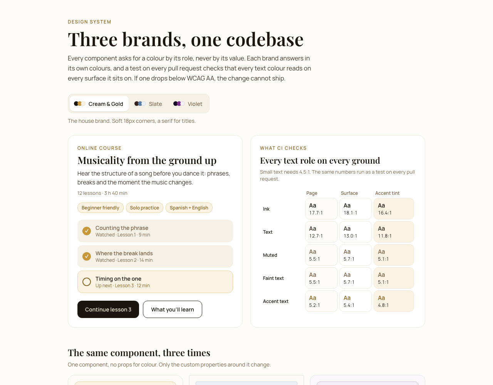

# Three brands, one codebase

[](https://github.com/flamingointheweb/design-system-showcase/actions/workflows/ci.yml)

A themed design system where every text colour is checked against WCAG AA on every pull request. If a colour drops below 4.5:1 on any surface it sits on, CI fails and the change cannot ship.



**Live demo:** [design-system-showcase-sage.vercel.app](https://design-system-showcase-sage.vercel.app)

## The problem

I run a platform for a dance event. Most of it wears the event's own brand. Then two artists started selling their courses on it, and their pages had to look like *theirs*: one wanted editorial slate blue with 3px corners, the other a violet from their logo. Same components, same code, three brands.

Brand colours are chosen for how they look, not how they read. The event's gold is 2.6:1 on its cream background: fine for a bar, unreadable as a 13px link. Every new palette was a new chance to ship text people can't read.

## How it works

**Components ask for roles, not colours.** A component never says "gold". It says `accentText`, `muted` or `ink`. Each palette in [`lib/palettes.ts`](lib/palettes.ts) answers with its own value, and the page applies it as CSS custom properties. Switching brand changes one object; no component knows which brand it's in.

**Fills and text are separate roles.** `accent` is the brand colour for bars, fills and icons. `accentText` is the same hue darkened until it reads as small text. The brand keeps its colour, and the words stay legible.

**The test checks every combination.** Five text roles, three surfaces, every palette:

```ts
describe.each(palettes)('palette "%s"', (key, t) => {
  for (const role of TEXT_ROLES) {
    const floor = KNOWN_GAPS[`${key}:${role}`] ?? AA_TEXT
    it(`${role} reads on every ground (≥ ${floor}:1)`, () => {
      const worst = Math.min(...GROUNDS.map((bg) => contrastRatio(t[role], t[bg])))
      expect(worst).toBeGreaterThanOrEqual(floor)
    })
  }
})
```

Adding a fourth brand adds its checks automatically. Adding a new role or surface means adding it to one list.

**Known gaps are pinned, not ignored.** One brand's faintest text is 3.5:1, and changing it is the brand owner's call. Instead of skipping the check, the test pins today's ratio as the floor, so it can only get better. A second test fails if the gap is fixed and the entry is left behind.

The demo page shows the same numbers live: switch brands and the contrast matrix updates.

## Details

- **Brand switcher** is a radio group: arrow keys move between brands, and only the selected one is in the tab order.
- **Dialog** is a native `<dialog>`: focus moves in, Escape closes it, focus returns to the button that opened it.
- **Brand changes cross-fade** over 280ms, and don't animate at all with `prefers-reduced-motion`.
- **Fonts** are loaded once as CSS variables, two families per brand, so switching never fetches anything.
- Touch targets are at least 40px, and the layout holds at 375px with no sideways scroll.

## Run it

```bash
npm install
npm run dev       # http://localhost:3000
npm test          # contrast and palette tests
npm run typecheck
```

CI runs the typecheck, the tests and a production build on every pull request ([`.github/workflows/ci.yml`](.github/workflows/ci.yml)).

## Stack

Next.js 16 (App Router), React 19, TypeScript (strict), Vitest.

---

The palettes come from a production platform I designed and built, [Bachata Connect](https://yennyotero.com). Its repository is private because it holds participant data; this is the design system extracted from it.

[yennyotero.com](https://yennyotero.com) · [LinkedIn](https://www.linkedin.com/in/yennyotero/)
